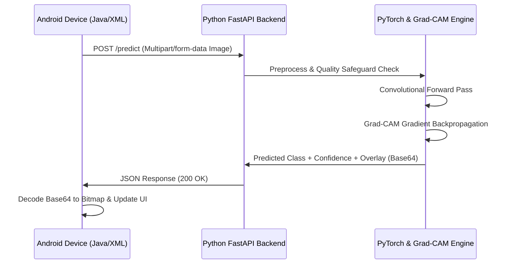

# Android Studio Integration Guide: Explainable WBC Classification
**Connecting an Android Mobile Client (Java / XML) to the Python FastAPI Backend**

---

## 1. Overview
This architectural guide provides complete instructions and production-grade source code for building an Android Studio application (Java & XML) that captures or uploads a peripheral blood smear microscopy image, sends it to the Python FastAPI backend (`/predict`), and renders both the 5-class differential prediction and the visual **Grad-CAM attribution overlay**.

---

## 2. System Architecture



---

## 3. Android Project Setup

### 3.1 Dependencies (`app/build.gradle`)
Add Retrofit, OkHttp, and Gson:
```groovy
dependencies {
    implementation 'androidx.appcompat:appcompat:1.6.1'
    implementation 'com.google.android.material:material:1.11.0'
    implementation 'androidx.constraintlayout:constraintlayout:2.1.4'

    // Retrofit & Networking
    implementation 'com.squareup.retrofit2:retrofit:2.9.0'
    implementation 'com.squareup.retrofit2:converter-gson:2.9.0'
    implementation 'com.squareup.okhttp3:logging-interceptor:4.12.0'
}
```

### 3.2 Permissions & Network Security (`AndroidManifest.xml`)
For local IP development (e.g. `http://10.0.2.2:8000` on Android Emulator, or `http://192.168.1.X:8000` on a physical device over Wi-Fi), permit Internet access and cleartext HTTP traffic:

```xml
<manifest xmlns:android="http://schemas.android.com/apk/res/android"
    package="com.example.wbcclassifier">

    <uses-permission android:name="android.permission.INTERNET" />
    <uses-permission android:name="android.permission.READ_MEDIA_IMAGES" />

    <application
        android:allowBackup="true"
        android:icon="@mipmap/ic_launcher"
        android:label="WBC Classifier"
        android:roundIcon="@mipmap/ic_launcher_round"
        android:supportsRtl="true"
        android:theme="@style/Theme.MaterialComponents.DayNight.NoActionBar"
        android:usesCleartextTraffic="true">
        <activity
            android:name=".MainActivity"
            android:exported="true">
            <intent-filter>
                <action android:name="android.intent.action.MAIN" />
                <category android:name="android.intent.category.LAUNCHER" />
            </intent-filter>
        </activity>
    </application>
</manifest>
```

---

## 4. XML UI Layout (`res/layout/activity_main.xml`)

```xml
<?xml version="1.0" encoding="utf-8"?>
<ScrollView xmlns:android="http://schemas.android.com/apk/res/android"
    xmlns:app="http://schemas.android.com/apk/res-auto"
    android:layout_width="match_parent"
    android:layout_height="match_parent"
    android:background="#F8FAFC"
    android:padding="16dp">

    <LinearLayout
        android:layout_width="match_parent"
        android:layout_height="wrap_content"
        android:orientation="vertical">

        <!-- Title -->
        <TextView
            android:layout_width="wrap_content"
            android:layout_height="wrap_content"
            android:text="WBC AI Classifier"
            android:textColor="#1E3A8A"
            android:textSize="24sp"
            android:textStyle="bold" />

        <TextView
            android:layout_width="wrap_content"
            android:layout_height="wrap_content"
            android:text="Explainable Leukocyte Identification with Grad-CAM"
            android:textColor="#64748B"
            android:textSize="14sp"
            android:layout_marginBottom="16dp" />

        <!-- Image Selection Buttons -->
        <LinearLayout
            android:layout_width="match_parent"
            android:layout_height="wrap_content"
            android:orientation="horizontal"
            android:weightSum="2">

            <Button
                android:id="@+id/btnSelectImage"
                android:layout_width="0dp"
                android:layout_height="wrap_content"
                android:layout_weight="1"
                android:layout_marginEnd="8dp"
                android:backgroundTint="#2563EB"
                android:text="Choose Image" />

            <Button
                android:id="@+id/btnPredict"
                android:layout_width="0dp"
                android:layout_height="wrap_content"
                android:layout_weight="1"
                android:backgroundTint="#059669"
                android:text="Classify Cell" />
        </LinearLayout>

        <!-- Progress Indicator -->
        <ProgressBar
            android:id="@+id/progressBar"
            android:layout_width="wrap_content"
            android:layout_height="wrap_content"
            android:layout_gravity="center"
            android:visibility="gone"
            android:layout_marginTop="12dp" />

        <!-- Side-by-Side Images -->
        <LinearLayout
            android:layout_width="match_parent"
            android:layout_height="wrap_content"
            android:orientation="horizontal"
            android:layout_marginTop="16dp"
            android:weightSum="2">

            <LinearLayout
                android:layout_width="0dp"
                android:layout_height="wrap_content"
                android:layout_weight="1"
                android:orientation="vertical"
                android:gravity="center">

                <TextView
                    android:layout_width="wrap_content"
                    android:layout_height="wrap_content"
                    android:text="Original Smear"
                    android:textStyle="bold" />

                <ImageView
                    android:id="@+id/ivOriginal"
                    android:layout_width="150dp"
                    android:layout_height="150dp"
                    android:background="#E2E8F0"
                    android:scaleType="centerCrop"
                    android:layout_marginTop="6dp" />
            </LinearLayout>

            <LinearLayout
                android:layout_width="0dp"
                android:layout_height="wrap_content"
                android:layout_weight="1"
                android:orientation="vertical"
                android:gravity="center">

                <TextView
                    android:layout_width="wrap_content"
                    android:layout_height="wrap_content"
                    android:text="Grad-CAM Overlay"
                    android:textStyle="bold" />

                <ImageView
                    android:id="@+id/ivGradCAM"
                    android:layout_width="150dp"
                    android:layout_height="150dp"
                    android:background="#E2E8F0"
                    android:scaleType="centerCrop"
                    android:layout_marginTop="6dp" />
            </LinearLayout>
        </LinearLayout>

        <!-- Classification Results Card -->
        <com.google.android.material.card.MaterialCardView
            android:layout_width="match_parent"
            android:layout_height="wrap_content"
            android:layout_marginTop="20dp"
            app:cardCornerRadius="10dp"
            app:cardElevation="2dp"
            app:strokeColor="#CBD5E1"
            app:strokeWidth="1dp">

            <LinearLayout
                android:layout_width="match_parent"
                android:layout_height="wrap_content"
                android:orientation="vertical"
                android:padding="16dp">

                <TextView
                    android:id="@+id/tvPrediction"
                    android:layout_width="wrap_content"
                    android:layout_height="wrap_content"
                    android:text="Prediction: Awaiting Image..."
                    android:textSize="18sp"
                    android:textColor="#0F172A"
                    android:textStyle="bold" />

                <TextView
                    android:id="@+id/tvConfidence"
                    android:layout_width="wrap_content"
                    android:layout_height="wrap_content"
                    android:text="Confidence: --"
                    android:textColor="#3B82F6"
                    android:layout_marginTop="4dp" />

                <TextView
                    android:id="@+id/tvNarrative"
                    android:layout_width="wrap_content"
                    android:layout_height="wrap_content"
                    android:text="Attribution explanation will appear here."
                    android:textColor="#475569"
                    android:textSize="13sp"
                    android:layout_marginTop="8dp" />
            </LinearLayout>
        </com.google.android.material.card.MaterialCardView>

        <!-- Educational Disclaimer -->
        <TextView
            android:layout_width="match_parent"
            android:layout_height="wrap_content"
            android:text="⚠️ Educational prototype only. Not for medical diagnosis."
            android:textSize="11sp"
            android:textColor="#B45309"
            android:gravity="center"
            android:layout_marginTop="16dp" />

    </LinearLayout>
</ScrollView>
```

---

## 5. Java Implementation

### 5.1 POJO Models (`PredictionResponse.java`)
```java
package com.example.wbcclassifier;

import com.google.gson.annotations.SerializedName;
import java.util.Map;

public class PredictionResponse {
    @SerializedName("predicted_class")
    public String predictedClass;

    @SerializedName("confidence")
    public float confidence;

    @SerializedName("score_breakdown")
    public Map<String, Float> scoreBreakdown;

    @SerializedName("explanation_narrative")
    public String explanationNarrative;

    @SerializedName("overlay_base64")
    public String overlayBase64;

    @SerializedName("model_name")
    public String modelName;
}
```

### 5.2 Retrofit Interface (`WbcApiService.java`)
```java
package com.example.wbcclassifier;

import okhttp3.MultipartBody;
import retrofit2.Call;
import retrofit2.http.Multipart;
import retrofit2.http.POST;
import retrofit2.http.Part;

public interface WbcApiService {
    @Multipart
    @POST("/predict")
    Call<PredictionResponse> predictCell(
        @Part MultipartBody.Part file
    );
}
```

### 5.3 Main Activity (`MainActivity.java`)
```java
package com.example.wbcclassifier;

import android.content.Intent;
import android.graphics.Bitmap;
import android.graphics.BitmapFactory;
import android.net.Uri;
import android.os.Bundle;
import android.util.Base64;
import android.view.View;
import android.widget.Button;
import android.widget.ImageView;
import android.widget.ProgressBar;
import android.widget.TextView;
import android.widget.Toast;

import androidx.annotation.Nullable;
import androidx.appcompat.app.AppCompatActivity;

import java.io.ByteArrayOutputStream;
import java.io.InputStream;

import okhttp3.MediaType;
import okhttp3.MultipartBody;
import okhttp3.RequestBody;
import retrofit2.Call;
import retrofit2.Callback;
import retrofit2.Response;
import retrofit2.Retrofit;
import retrofit2.converter.gson.GsonConverterFactory;

public class MainActivity extends AppCompatActivity {

    private static final int PICK_IMAGE_REQUEST = 101;
    // For Android Studio Emulator, 10.0.2.2 maps to host PC localhost:8000
    private static final String BASE_URL = "http://10.0.2.2:8000/";

    private ImageView ivOriginal, ivGradCAM;
    private TextView tvPrediction, tvConfidence, tvNarrative;
    private ProgressBar progressBar;
    private Uri selectedImageUri;
    private WbcApiService apiService;

    @Override
    protected void onCreate(Bundle savedInstanceState) {
        super.onCreate(savedInstanceState);
        setContentView(R.layout.activity_main);

        ivOriginal = findViewById(R.id.ivOriginal);
        ivGradCAM = findViewById(R.id.ivGradCAM);
        tvPrediction = findViewById(R.id.tvPrediction);
        tvConfidence = findViewById(R.id.tvConfidence);
        tvNarrative = findViewById(R.id.tvNarrative);
        progressBar = findViewById(R.id.progressBar);

        Button btnSelect = findViewById(R.id.btnSelectImage);
        Button btnPredict = findViewById(R.id.btnPredict);

        // Initialize Retrofit
        Retrofit retrofit = new Retrofit.Builder()
                .baseUrl(BASE_URL)
                .addConverterFactory(GsonConverterFactory.create())
                .build();

        apiService = retrofit.create(WbcApiService.class);

        btnSelect.setOnClickListener(v -> openGallery());
        btnPredict.setOnClickListener(v -> uploadAndClassify());
    }

    private void openGallery() {
        Intent intent = new Intent(Intent.ACTION_GET_CONTENT);
        intent.setType("image/*");
        startActivityForResult(intent, PICK_IMAGE_REQUEST);
    }

    @Override
    protected void onActivityResult(int requestCode, int resultCode, @Nullable Intent data) {
        super.onActivityResult(requestCode, resultCode, data);
        if (requestCode == PICK_IMAGE_REQUEST && resultCode == RESULT_OK && data != null && data.getData() != null) {
            selectedImageUri = data.getData();
            ivOriginal.setImageURI(selectedImageUri);
            ivGradCAM.setImageDrawable(null);
            tvPrediction.setText("Image selected. Ready to classify.");
            tvConfidence.setText("");
            tvNarrative.setText("");
        }
    }

    private void uploadAndClassify() {
        if (selectedImageUri == null) {
            Toast.makeText(this, "Please choose an image first!", Toast.LENGTH_SHORT).show();
            return;
        }

        progressBar.setVisibility(View.VISIBLE);

        try {
            InputStream is = getContentResolver().openInputStream(selectedImageUri);
            ByteArrayOutputStream buffer = new ByteArrayOutputStream();
            int nRead;
            byte[] data = new byte[16384];
            while ((nRead = is.read(data, 0, data.length)) != -1) {
                buffer.write(data, 0, nRead);
            }
            byte[] bytes = buffer.toByteArray();

            RequestBody requestFile = RequestBody.create(MediaType.parse("image/jpeg"), bytes);
            MultipartBody.Part body = MultipartBody.Part.createFormData("file", "cell_smear.jpg", requestFile);

            apiService.predictCell(body).enqueue(new Callback<PredictionResponse>() {
                @Override
                public void onResponse(Call<PredictionResponse> call, Response<PredictionResponse> response) {
                    progressBar.setVisibility(View.GONE);
                    if (response.isSuccessful() && response.body() != null) {
                        PredictionResponse res = response.body();
                        tvPrediction.setText("Prediction: " + res.predictedClass);
                        tvConfidence.setText("Confidence: " + String.format("%.2f%%", res.confidence * 100));
                        tvNarrative.setText(res.explanationNarrative);

                        // Decode Grad-CAM Base64 string into Bitmap
                        if (res.overlayBase64 != null) {
                            byte[] decodedBytes = Base64.decode(res.overlayBase64, Base64.DEFAULT);
                            Bitmap decodedBitmap = BitmapFactory.decodeByteArray(decodedBytes, 0, decodedBytes.length);
                            ivGradCAM.setImageBitmap(decodedBitmap);
                        }
                    } else {
                        Toast.makeText(MainActivity.this, "Server error: " + response.code(), Toast.LENGTH_LONG).show();
                    }
                }

                @Override
                public void onFailure(Call<PredictionResponse> call, Throwable t) {
                    progressBar.setVisibility(View.GONE);
                    Toast.makeText(MainActivity.this, "Connection failed: " + t.getMessage(), Toast.LENGTH_LONG).show();
                }
            });

        } catch (Exception e) {
            progressBar.setVisibility(View.GONE);
            Toast.makeText(this, "Error processing image: " + e.getMessage(), Toast.LENGTH_LONG).show();
        }
    }
}
```

---

## 6. Testing the Integration
1. **Start Python API**:
   ```powershell
   conda activate wbc-ai
   python src/api.py
   ```
2. **Verify via Browser or Curl**:
   Navigate to `http://localhost:8000/docs` to test Swagger UI interactive docs.
3. **Launch Android App in Emulator**:
   The emulator accesses host machine at `http://10.0.2.2:8000`. Selecting a cell image and tapping "Classify Cell" will render the prediction and Grad-CAM overlay seamlessly.
