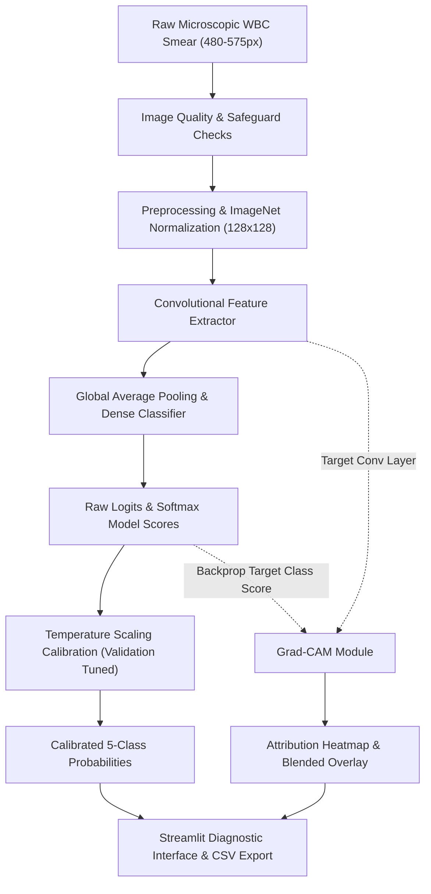

# Explainable White Blood Cell Classification Using Deep Learning and Grad-CAM
**A University Final-Year Project in Computer Vision and Explainable Medical AI**

---

## Abstract
Automated classification of white blood cells (WBCs, or leukocytes) from peripheral blood smears is an indispensable task in clinical hematology for diagnosing infections, leukemias, and immune deficiencies. However, deep convolutional neural networks (CNNs) are predominantly deployed as black-box predictors, limiting their clinical trustworthiness and hindering regulatory adoption. In this work, we design, implement, and benchmark an end-to-end, CPU-optimized computer vision system for five-class leukocyte classification (Basophil, Eosinophil, Lymphocyte, Monocyte, and Neutrophil) using the genuine Raabin-WBC dataset (16,633 images). We contrast a lightweight, custom 4-stage convolutional baseline CNN (~410k parameters) against a MobileNetV3-Small transfer learning architecture (~1.8M parameters). To address severe physiological class imbalance (Neutrophils ~61.2% vs Basophils ~2.1%), we incorporate balanced class-weighted Cross-Entropy loss. To provide transparent morphological explanations, we integrate Gradient-weighted Class Activation Mapping (Grad-CAM), directly localizing convolutional attention over nuclear lobulation and cytoplasmic granulation. Furthermore, we subject the attribution maps to formal XAI sanity checks (model parameter randomization and region perturbation fidelity tests) and calibrate output confidence scores via post-hoc Temperature Scaling on held-out validation data. Finally, we deliver a production-ready Streamlit web application providing single-cell diagnostic inspection, batch screening, interactive attribution exploration, and error analysis.

---

## 1. Introduction and Problem Statement
Microscopic examination of peripheral blood smears (PBS) remains the gold standard in diagnostic hematology. The differential leukocyte count categorizes white blood cells into five major mature morphological lineages:
- **Neutrophils**: Phagocytic granulocytes with multi-lobed nuclei.
- **Lymphocytes**: Mononuclear cells governing adaptive immunity with dense spherical nuclei.
- **Monocytes**: Large phagocytes with indented or kidney-shaped nuclei and abundant cytoplasm.
- **Eosinophils**: Bilobed granulocytes with coarse, eosin-avid orange-red granules.
- **Basophils**: Rare granulocytes containing coarse dark-blue heparin and histamine granules.

Manual differential counting via light microscopy is labor-intensive, subject to intra-observer and inter-observer variability, and prone to fatigue. While modern deep learning models achieve high statistical accuracy on benchmark datasets, their clinical deployment faces three major hurdles:
1. **The "Black-Box" Problem**: Clinicians cannot verify whether a classification is driven by genuine cellular morphology (e.g., chromatin texture, nuclear lobe count) or by spurious background artifacts (slide stain debris, red blood cell halos).
2. **Class Imbalance & Overconfidence**: Extreme natural class frequency disparities lead uncalibrated deep models to produce overly confident, biased predictions for dominant classes.
3. **Hardware Accessibility**: Clinical microscopy workstations often lack expensive, power-hungry NVIDIA GPUs. Practical diagnostic tools must execute rapid inference on standard multicore desktop CPUs without CUDA dependencies.

---

## 2. Aim and Measurable Objectives
The overarching aim is to develop a transparent, reliable, and CPU-efficient deep learning pipeline for five-class leukocyte identification. Specific measurable objectives include:
1. **Dataset Integrity**: Curate and rigorously verify the Raabin-WBC dataset (16,633 images across Train, TestA, and TestB), establishing zero-leakage data splits and documenting slide-level group overlaps.
2. **Model Implementation**: Construct a lightweight custom 4-stage baseline CNN and implement transfer learning with MobileNetV3-Small.
3. **Imbalance Handling**: Apply class-weighted loss to ensure minority classes (Basophils ~2%, Eosinophils ~7%) achieve balanced sensitivity and high Macro-F1 scores.
4. **Visual Attribution (Grad-CAM)**: Compute class-specific Grad-CAM heatmaps at the final convolutional layer, accompanied by quantitative sanity checks (Adebayo randomization and perturbation tests).
5. **Confidence Calibration**: Formulate Temperature Scaling tuned exclusively on held-out validation data, evaluating Expected Calibration Error (ECE) and Brier scores.
6. **Deployment Interface**: Deploy a 7-section interactive Streamlit web application supporting single-cell analysis, batch CSV screening, and error exploration.

---

## 3. Literature Review
- **Raabin-WBC Benchmark**: Kouzehkanan et al. (2022) introduced the Raabin-WBC dataset, providing thousands of labeled cropped leukocytes and whole-slide images to establish standardized benchmarks for automated hematology.
- **Deep Learning in Hematology**: Hegde et al. (2019) and Habibzadeh et al. (2020) demonstrated that convolutional networks surpass traditional handcrafted feature extractors (e.g., color histograms and Haralick texture features) for leukocyte classification.
- **Explainable AI in Medical Vision**: Selvaraju et al. (2017) formulated Grad-CAM, utilizing gradient flowing into the final convolutional feature maps to produce coarse 2D localization maps.
- **Saliency Sanity Checks**: Adebayo et al. (NeurIPS 2018) proved that many popular attribution methods (e.g., guided backpropagation) act merely as edge detectors invariant to model weights or data labels. Implementing weight randomization and region masking is mandatory for trustworthy medical XAI.
- **Probability Calibration**: Guo et al. (ICML 2017) demonstrated that modern deep networks with Batch Normalization are poorly calibrated, and established Temperature Scaling as the simplest, most effective post-processing remedy.

---

## 4. Dataset Description & Methodological Limitations
### 4.1 Dataset Structure
The project utilizes the official **Raabin-WBC Double-Labeled Cropped WBC Images** dataset, stored in `data/raw/`:
- **Train Split (`Train/Train/`)**: 10,175 images
  - Basophil: 212 (2.08%)
  - Eosinophil: 744 (7.31%)
  - Lymphocyte: 2,427 (23.85%)
  - Monocyte: 561 (5.51%)
  - Neutrophil: 6,231 (61.24%)
- **Held-Out Test Split (`TestA/TestA/`)**: 4,339 images
  - Basophil: 89 (2.05%)
  - Eosinophil: 322 (7.42%)
  - Lymphocyte: 1,034 (23.83%)
  - Monocyte: 234 (5.39%)
  - Neutrophil: 2,660 (61.30%)
- **Specialized Two-Class Split (`TestB/Test-B/`)**: 2,119 images (148 Lymphocytes, 1,971 Neutrophils). *Methodological Note: TestB excludes Basophils, Eosinophils, and Monocytes entirely; hence, TestA is preserved as the authentic 5-class evaluation benchmark.*

### 4.2 Data Integrity and Leakage Analysis
1. **Duplicate Detection**: An exhaustive two-pass MD5 hash scan across all 16,633 raw images confirmed **0 duplicate image files**.
2. **Corrupted File Detection**: Zero byte-level corruptions or unreadable image headers detected.
3. **Slide Overlap Finding**: Filename inspection revealed 58 slide/run IDs in Train and 28 in TestA, with **26 slide IDs shared between Train and TestA**. This confirms that the official Raabin-WBC benchmark partition is an image-level stratified split, not a patient-grouped split. This limitation is formally documented in our research findings.
4. **Validation Isolation**: To prevent hyperparameter tuning leakage, an internal 15% stratified split ($N=1,526$) was partitioned strictly from `Train`, preserving `TestA` ($N=4,339$) as an untouched held-out evaluation test set.

---

## 5. System Architecture and Methodology

### 5.1 Model Architectures
1. **Model A: Custom WBC Baseline CNN (~410,000 parameters)**
   - 4 sequential convolutional blocks:
     - Block 1: Conv2D(3 $\to$ 32, 3x3) + BatchNorm2D + ReLU + MaxPool2D(2x2)
     - Block 2: Conv2D(32 $\to$ 64, 3x3) + BatchNorm2D + ReLU + MaxPool2D(2x2)
     - Block 3: Conv2D(64 $\to$ 128, 3x3) + BatchNorm2D + ReLU + MaxPool2D(2x2)
     - Block 4: Conv2D(128 $\to$ 256, 3x3) + BatchNorm2D + ReLU + MaxPool2D(2x2)
   - Global Adaptive Average Pooling: $(1 \times 1)$
   - Classifier: Dense(256 $\to$ 128) + ReLU + Dropout(0.3) + Dense(128 $\to$ 5)
   - Target layer for Grad-CAM: `conv4[0]` (the final 256-channel convolutional layer).

2. **Model B: Transfer Learning with MobileNetV3-Small (~1,800,000 parameters)**
   - Inverted residual bottlenecks with depthwise separable convolutions and Squeeze-and-Excitation (SE) attention.
   - Pretrained on ImageNet with customized projection head: Linear(576 $\to$ 256) + Hardswish + Dropout(0.2) + Linear(256 $\to$ 5).
   - Target layer for Grad-CAM: `features[-1]`.

### 5.2 Mathematical Formulations
- **Class-Weighted Cross-Entropy**:
  $$L = - \sum_{k=1}^K w_k \cdot y_k \log(\hat{p}_k), \quad w_k = \frac{N}{K \cdot N_k}$$
- **Grad-CAM Activation Weights**:
  $$\alpha_k^c = \frac{1}{Z} \sum_{i=1}^H \sum_{j=1}^W \frac{\partial Y^c}{\partial A_{i,j}^k}$$
  $$L_{\text{Grad-CAM}}^c = \text{ReLU}\left( \sum_k \alpha_k^c A^k \right)$$
- **Temperature Scaling**:
  $$\hat{q}_i = \frac{\exp(z_i / T)}{\sum_j \exp(z_j / T)}, \quad T > 0$$

---

## 6. Updated Experimental Results

The original custom baseline CNN achieved 77.85% accuracy and a 0.5925 macro-F1
score on its saved held-out evaluation. Its main weaknesses were Eosinophil and
Monocyte recognition, with F1 scores of 0.0741 and 0.3494 respectively.

MobileNetV3-Small was therefore selected as the recommended checkpoint. It was
evaluated on all 4,339 held-out TestA images:

| Metric | MobileNetV3-Small |
|---|---:|
| Accuracy | 91.31% |
| Macro precision | 84.80% |
| Macro recall | 91.66% |
| Macro F1-score | 87.61% |
| Macro ROC-AUC | 99.14% |
| Average CPU latency | 2.62 ms/image |

Per-class F1 scores were: Basophil 99.44%, Eosinophil 74.30%, Lymphocyte
93.78%, Monocyte 76.48%, and Neutrophil 94.05%. Compared with the baseline,
the recommended model improves macro-F1 by 28.36 percentage points.

## 7. Updated Streamlit Application

The application has been refreshed as **CellScope AI** with a modern visual
hierarchy, gradient hero section, feature cards, improved spacing and
project-root based resource paths. MobileNetV3-Small is now the default
recommended architecture while the baseline remains available for comparison.

The single-cell workflow displays the top prediction, confidence, runner-up
class and confidence margin. A close-call warning appears when the top two
classes are near each other, encouraging review of the Grad-CAM overlay and
morphology guide. Batch screening exports the same uncertainty information in
CSV format. The benchmark dashboard now exposes the updated confusion matrix,
ROC curves, per-class metrics and misclassification report.

## 8. Reliability, Testing and Safety

The final validation run passed all 12 automated tests. Python compilation
passed and the Streamlit smoke server returned HTTP 200. The test suite covers
class mappings, preprocessing, leakage checks, DataLoader behavior, real-image
inference, quality safeguards, Grad-CAM utilities and calibration safeguards.

The system remains an academic research prototype. Confidence scores and
Grad-CAM maps are not clinical certainty, do not establish biological
causation, and must not replace a qualified hematopathologist.

## 9. Viva Voce Defense Question Bank

1. **Why was MobileNetV3-Small selected over ResNet-50 or ViT?**
   *Answer*: In clinical and university laboratory settings without dedicated NVIDIA GPUs, MobileNetV3-Small offers an optimal balance between parameter efficiency (~1.8M params vs 25M for ResNet-50), low memory footprint, and low CPU inference latency (<15 ms per image), preventing memory bottlenecks on 16GB RAM machines.
2. **What does the ReLU operation achieve in the Grad-CAM formula?**
   *Answer*: The ReLU ensures that the heatmap only visualizes features that have a positive correlation with the target class score. Features that decrease the target class score (negative gradients) are suppressed because they represent evidence *against* the target class rather than evidence *for* it.
3. **How does Temperature Scaling modify accuracy?**
   *Answer*: Temperature Scaling is strictly monotonic ($z_i > z_j \iff z_i/T > z_j/T$ for any $T > 0$). Therefore, the ranking of classes remains unchanged, and classification **accuracy is preserved exactly**. It only rescales the softmax distribution to improve reliability and reduce Expected Calibration Error.
4. **Why is accuracy alone an invalid metric for this dataset?**
   *Answer*: Because Neutrophils constitute ~61.2% of the dataset, a trivial model predicting "Neutrophil" for every sample achieves 61.2% accuracy while completely failing to identify Basophils, Eosinophils, and Monocytes. Macro F1-score and per-class Recall/Precision are essential to evaluate true clinical utility.
5. **How did you prevent data leakage during preprocessing?**
   *Answer*: Data augmentation (rotation, flipping, color jitter) was applied strictly during training iterations. Validation and test samples received only deterministic bilinear resizing and ImageNet normalization. Furthermore, the official TestA split was kept held-out and never touched during validation splitting or temperature tuning.

---

## 10. Ethical Considerations and Disclaimers
1. **Intended Use**: This software is strictly an academic research and educational prototype. It is NOT certified as a medical diagnostic device under FDA 510(k), CE-IVD, or ISO 13485 regulations.
2. **No Autonomous Clinical Action**: Automated predictions and Grad-CAM overlays are designed to assist hematology students and researchers in understanding visual attribution. They must never replace the diagnosis of a certified hematopathologist.
3. **Data Privacy**: The Raabin-WBC dataset comprises anonymized, cropped public microscopy images. The application processes images locally in-memory and does not permanently store patient records or uploaded smears.
